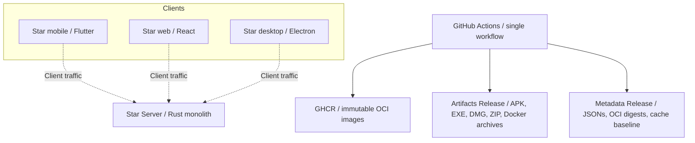

# Architecture

Star is organized as three source trees and a shared build-and-release layer. This document describes the **repository layout and verified build boundaries**, not a certified production deployment.

## Component map

The arrows between clients and the server describe the intended product relationship. They are not a claim that a public server or complete messaging service has passed end-to-end tests in this repository.

## Source directories and dependencies

| Directory | Primary responsibility | Build impact |
| --- | --- | --- |
| [Star web](../Star%20web/) | Web UI, shared Rust and TypeScript packages, Electron desktop renderer | Web assets, desktop renderer, APK native Rust dependencies, and desktop installers |
| [Star mobile](../Star%20mobile/) | Flutter/Dart mobile application and Android packaging | Android APK |
| [Star Server](../Star%20Server/) | Rust-based server, internal services, monolithic Docker runtime | Server OCI image |
| [Docker](../Docker/) | Dockerfiles, Compose profile, Android toolchain, release and cache scripts | Infrastructure jobs according to the specific changed build inputs |
| [GitHub workflow](../.github/workflows/docker-publish.yml) | Source validation, per-component build planning, native packaging, publication | No separate server or per-platform workflow |

### Web and Server are different source snapshots

`Star web/` and `Star Server/` each contain an overlapping 16,579-file monorepo snapshot. In the audit of commit `a4be8a8`, only four paths differed and the two `Cargo.lock` files had the **same Git blob hash**. The copies are nevertheless **not synchronized automatically**.

The self-hosted server image is built from the `Star Server/` tree. The separate Web Assets image is a build output, **not another running web server**, and is not automatically injected into the Server image. A frontend fix in one tree may not appear in the other.

Before production, reconcile the source duplication and define an explicit source-of-truth or versioned component update procedure.

## Local runtime

The development Compose file starts the monolithic `star` service by default. Other images are opt-in build profiles.

- Browser: `http://localhost:8080`, bound to `127.0.0.1` by default.
- Server data: stored in a Docker named volume.
- Health check: uses the server executable's built-in health command.
- Voice network ports: local bindings are configured in [Compose](../Docker/compose.yaml).

`./star.sh down` preserves persistent data. Do not use `docker compose down -v` without a tested backup.

No public hosting, TLS configuration, backups, email, push delivery, or WebRTC connectivity should be inferred from a successful local container startup. See [Docker/README.md](../Docker/README.md).

## Build and release data flow

The single GitHub workflow runs in stages:

1. **Validate and plan.** Test scripts, check Compose inputs, compute source fingerprints and compare them with the immutable published baseline.
2. **Prepare Releases.** Create one artifacts Release and one JSON metadata Release for the commit, except in plan-only or backfill mode.
3. **Build affected images.** Publish changed Web, Desktop, Mobile Builder, and/or Server images to GHCR with SHA-associated tags and OCI digests.
4. **Package affected installers.** Android runs inside the Mobile Builder image. macOS and Windows use native runners with a renderer extracted from the Desktop OCI image or its cached immutable digest.
5. **Publish progressively.** Upload only new artifacts, export Docker images as compressed archives, and record JSON manifests.
6. **Record the next baseline.** After all required jobs succeed, publish the incremental build map and link unchanged binaries to their original Releases.

Read the [operational release guide](build-and-release.md) for modes, artifact naming, checksums, permissions, and troubleshooting.

## Trust boundaries

- **Development Compose is local-only.** Use a separate, reviewed deployment profile for internet access.
- **Secrets stay out of Git.** Sample `.env.example` is public; actual `Docker/.env` is local and should remain ignored.
- **GitHub Actions permissions are scoped per job.** Image jobs require package publication access; Release jobs require content write access.
- **External Actions use immutable commit references.** Review and update pins deliberately, rather than relying on movable tags.
- **Release assets are technical previews.** Signing, notarization, integration testing, and security validation remain independent requirements.

## Related documentation

- [Main README](../README.md)
- [Docker development guide](../Docker/README.md)
- [Build and release operations](build-and-release.md)
- [Engineering audit and risks](engineering-audit.md)
- [Security policy](../SECURITY.md)
